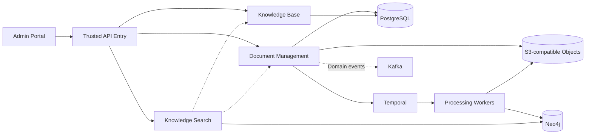

# Public Architecture Overview

**Status:** proposal for independent implementation; no organizational endorsement.

## Context

A standalone document and knowledge platform with three separately deployable APIs (Document Management, Knowledge Base, Knowledge Search), six processing capabilities (parse, chunk, embed, graph extract, index, preview), and a React administration portal.

## Core invariants

- Deny-by-default, tenant-scoped resource authorization; verify results at the response boundary.
- Immutable document versions and processing artifacts, with publication approval.
- Staged indexing followed by an authoritative PostgreSQL active-version switch.
- Separate data ownership for each domain; avoid cross-service table access.
- Durable processing intent, idempotent Temporal workflow dispatch, and Kafka outbox events.
- Neo4j indexes are derived and may be rebuilt; invalid graph assertions are excluded.
- Independent service releases within a domain-oriented monorepo.
- Runtime configuration and model versions are pinned and auditable.

## Caveats

This document deliberately omits organization-specific information and operational claims. Availability, security isolation, throughput and disaster recovery are unverified until tested and approved.
