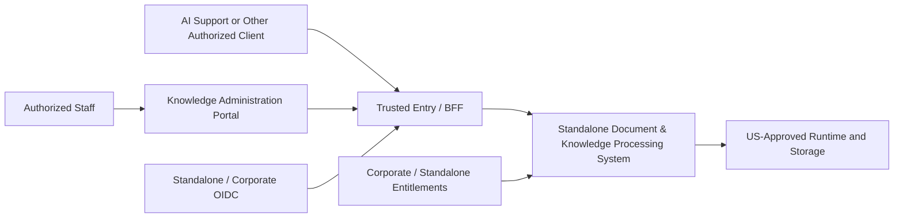
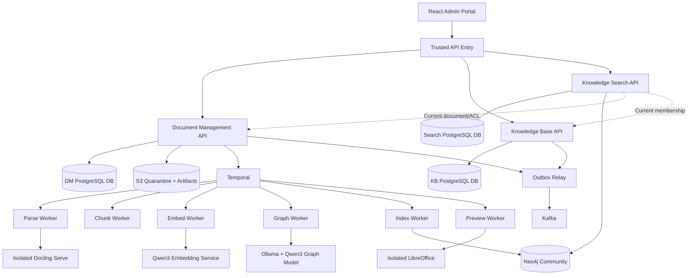

# Document & Knowledge Processing System — System Design Specification

**Document ID:** DKPS-SDD-001  
**Version:** 1.0.0-rc1-public  
**Date:** 2026-10-31  
**Language:** English  
**Status:** PUBLIC DESIGN DRAFT — blueprint input; **not production-approved**  
**Architecture decision baseline:** DM-001 through DM-072 (user-selected in design discussion)  
**Source basis:** User-selected standalone architecture decisions DM-001–DM-072; public design principles and technical requirements.
**Deployment intent:** Independently developed and operated through versioned contracts.

> **Decision integrity.** “Selected” means a design direction, not verified performance, purchasing approval, security approval, or production release authorization. Technical targets require evidence; examples are not completed implementations.

## 1. Executive design decision and scope

The Document & Knowledge Processing System (DKPS) is a standalone enterprise document lifecycle, knowledge management, document intelligence, and secured retrieval platform. It exposes independently deployable Document Management, Knowledge Base, and Knowledge Search APIs through a trusted entry/BFF and includes a fully functional Knowledge Administration Portal. It is **not** the AI Support conversational assistant, RAG answer generator, support case engine, or general-purpose agent runtime.

**In scope:** approved staff upload; controlled metadata/version/ACL administration; quarantine and malware scanning; PDF/DOCX/PPTX/XLSX parsing; OCR for scanned PDFs; structure-aware chunking; self-hosted embeddings; automated knowledge graph extraction and evidence validation; versioned Neo4j semantic/lexical/graph indexing; collection membership and audience policy; human publication approval; secure previews/downloads/citations; search; retention, withdrawal and purge; resilient workflows/events; observability/audit; standalone OIDC; integrated external OIDC authorization adapters; deployment tooling and QA.

**Out of scope for v1:** general external-source connectors, conversational assistant, autonomous agent tooling, multilingual ingestion/query, customer self-service document upload, unbounded AI ontology generation, end-user generated Cypher, mandatory manual review of individual graph assertions, active-active regions, native Neo4j Community HA clustering, and automatic semantic-quality release blocking.

**Non-negotiable properties:** fail-closed tenant authorization; PostgreSQL-owned business state; immutable document versions and artifacts; no direct frontend access to persistence; no cross-service table writes; durable processing intents; no untrusted data becoming executable agent instructions; traceable citations; separation of core business state from derived indexes.

### 1.1 Chosen technology baseline

| Concern | Selected technology / rule | Qualification |
|---|---|---|
| Backend runtime | Java **25 LTS**, Micronaut | Pin supported stable Micronaut release compatible with Java 25; verify at implementation gate |
| Backend architecture | DDD + Hexagonal Ports/Adapters + modular microkernel/plugins | Controlled deployment; no arbitrary runtime code loading |
| User interface | React + TypeScript strict + Vite + React Router + TanStack React Query + Zod | Vitest, Testing Library and Playwright |
| Domain persistence | PostgreSQL, separately owned logical databases | One shared physical cluster initially; per-service users and migrations |
| Object storage | S3-compatible via `ObjectStoragePort` | Scoped keys; quarantine and immutable artifact storage |
| Retrieval / graph | One self-hosted **Neo4j Community** database | Shared index, scope-aware candidate retrieval; no native HA assumption |
| Orchestration | Self-hosted Temporal | Durable workflow with independently scalable workers |
| Domain event transport | Self-hosted Kafka | Transactional outbox, AsyncAPI, idempotent consumption |
| Parsing | Docling Serve isolated runtime | PDF/Office; quality-aware parser interface |
| Chunking | Docling HybridChunker + structure-aware adapters | Initial 512 target/768 max tokens; validate Qwen tokenizer behavior |
| Embeddings | Qwen3-Embedding-0.6B, 1024 dimensions | One active model, self-hosted; exact immutable revision pending |
| Graph extraction | Qwen3-4B-Instruct-2507 via Ollama | Hybrid deterministic + model extraction, automated evidence checks |
| Preview | Secure PDF browser viewer; headless LibreOffice DOCX/PPTX conversion; structured XLSX viewer | Isolated preview worker; secure original fallback |
| Identity | Standalone OIDC or integrated external OIDC | Keycloak candidate standalone; production SPIFFE/SPIRE + mTLS implementation |
| Development / production | Docker Compose / Kubernetes + GitOps | US-first production; self-hosted Temporal/Kafka/Neo4j |
| Repo / process | Domain-oriented polyglot monorepo; OpenSpec | Contract-first OpenAPI/AsyncAPI, generated Java/TS SDKs |
| Supply chain | Locked dependencies, image digests, SBOM, signatures | Exact versions and revisions pinned in release manifest |

## 2. Architecture decision status and reconciliation

### 2.1 Standalone design reconciliation summary

The 72 DM decisions are **selected as a coherent local system design**, with the explicit limitation that proof of production-grade capacity, recovery, security, and vendor compatibility remains outstanding. No fundamental business-domain choice is delegated to a coding agent. Implementation-level details may be finalized through OpenSpec with an owner and acceptance gates.

| Ref | Finding | Resolution / governing decision | Exit requirement |
|---|---|---|---|
| REC-01 | Multiple collection memberships vs one active document version | DM-018, DM-050, DM-051, DM-066 | Versioned audience compatibility validation and no automatic exposure |
| REC-02 | Membership changes can race publication across databases | **DM-072 A**: revision-based validation + fail-closed search, no distributed lock | Concurrency integration tests; detect policy revision drift; reconcile |
| REC-03 | Neo4j asynchronous index vs authorization freshness | DM-020, DM-054, DM-063 | Authorized candidate filtering and authoritative response-boundary check |
| REC-04 | Atomic version switch vs cross-system transactions | DM-035, DM-050 | Stage indexes, atomic PostgreSQL pointer+outbox transaction; never claim distributed atomicity |
| REC-05 | Optional graph enrichment vs processing readiness | DM-042, DM-049 | Core semantic+lexical readiness required, graph capability state explicit |
| REC-06 | Immutable versions vs controlled withdrawal/purge | DM-015 | Retention/legal-hold policy and cross-store purge workflow |
| REC-07 | Backup/restore instead of external warm standby | **Deviation from alternative DR policy**, DM-030/061 | Tiered DR objectives and demonstrated restore drills |
| REC-08 | Single Neo4j Community vs HA enterprise posture | DM-053/062 | Search outage isolated, 2h search recovery goal tested |
| REC-09 | Monorepo vs a prior multi-repository approach | **Deviation from alternative repository policy**, DM-023/058 | Independent build/deployment/version compatibility |
| REC-10 | Basic AI quality evaluation vs correctness assertions | DM-042/043/044 | Runtime per-assertion validation mandatory; quality regression alert/manual rollback; no quantitative gate invented |
| REC-11 | Signed direct download vs revocation | DM-047, DM-063 | Strong-revocation content through secured gateway; scoped signed links only where permitted |
| REC-12 | Search targets vs unknown real corpus | DM-026/045 | P95<=3s/P99<=6s at 50 rps under representative corpus, measured |
| REC-13 | Self-hosting vs model/Office license/runtime availability | DM-038/064/067/070 | License, security, provenance, pinned-image and hardware gate |
| REC-14 | Module outside core AI runtime | DM-001, DM-021 | No dependency on agent framework architecture-reference or assistant-specific gateways |

### 2.2 Reconciliation of DM-072 (selected)

**Choice:** `Versioned Policy Validation + Fail-Closed Search`.

1. KB maintains a monotonically ordered **membership/policy revision per affected collection/audience scope**, exposed by an authenticated, versioned authorization/compatibility API.
2. A publication command identifies intended version, expected document aggregate revision, audience classification, and the set of evaluated membership/policy revision tokens.
3. DM validates classification compatibility against KB before committing the publication pointer, checks its own aggregate version and approval/readiness. A mismatch or unavailable KB **blocks** activation.
4. Because KB and DM are independently transactional databases, a concurrent KB change after the last read remains possible. The design does **not** falsely claim a globally serializable commit. KB changes must independently enforce collection/member/document audience policy and may not expand beyond DM document ACL; Search always evaluates both authoritative services at response boundary.
5. When a revision conflict becomes known, an event or reconciliation job marks the membership/view invalid, prevents forbidden content exposure, and initiates operator-visible remediation. A pre-existing published version remains unchanged until a permitted publication command succeeds.
6. Every search result must pass publication, tenant, classification, collection membership, document ACL, and evidence visibility checks, or be excluded. Authorization dependency failures are fail-closed; avoid use of stale positive authorization caches.

**Guarantee:** No unauthorized content is returned by conforming Search/Content APIs after an authoritative denial is observed at the response boundary. **Non-guarantee:** No cross-service atomicity; a narrow race between last check and HTTP transmission is accepted under DM-063, not eliminated by policy revision tokens. Independent KB membership mutation paths need the same safety rules.

### 2.3 Readiness versus production approval

**Architecture design:** Ready for detailed implementation blueprint and initial OpenSpec work. **Implementation artifacts:** This document contains normative domain/data/API/event/workflow schemas and pseudocode; generated OpenAPI/AsyncAPI, validated migrations, and production configuration remain implementation deliverables. **Production approval:** NOT granted; requires quantified evidence from the test matrix and formal responsible-owner sign-off.

## 3. Architecture principles — public engineering checklist P01–P21

The following general engineering-principles checklist is included for design reviews. It does not represent organizationally approved policies. Items outside this standalone system are explicitly marked not applicable.

| Principle | Engineering principle | DKPS interpretation / compliance |
|---|---|---|
| **P01** | Minimal AI core; framework-native abstractions preferred | No conversational agent core; model and processing logic behind ports |
| **P02** | Clear ownership and independent lifecycle | DM/KB/Search own data and releases; independent workers; no cross-writes |
| **P03** | Contract-first versioning | OpenAPI, AsyncAPI, workflow and plugin contract versions |
| **P04** | Standard AG-UI/MCP/A2A protocols, no custom protocol clones | N/A in DKPS core; preserve standard, separately implemented future integration |
| **P05** | Operationally justified complexity | Shared physical DB allowed, no microservice per adapter; workload-driven deployment |
| **P06** | Zero trust, least privilege, external OIDC, RBAC/ABAC/ReBAC | Deny-by-default per-resource operation, independently enforced by services |
| **P07** | Verified service identities and protected egress/secrets | SPIFFE/SPIRE workload identity with actual mTLS integration; KMS; network policies |
| **P08** | Tenant isolation in every data layer | Scope S3, Neo4j graph evidence, caches, DB operations, audit and search |
| **P09** | Approved data residency for entire lifecycle | US-first data, backups, inference and telemetry; explicit provider exceptions only |
| **P10** | AI security, audit, secure software supply chain | Document prompt injection treated as data; SBOM/signing/provenance/audit |
| **P11** | Authorized, grounded hybrid RAG with citations and abstention | Evidence-rich secure retrieval; deny unsupported citations; answer generation is external |
| **P12** | Versioned knowledge pipeline and independent workers | Docling parse, hybrid chunking, embed, graph, index, immutable artifacts |
| **P13** | Model gateway/controlled providers and index migration | DKPS provider ports; provider allowlist; pinned models; new index on embedding changes |
| **P14** | Deterministic risk hard stops override AI decisions | Support auto-reply logic N/A; deterministic document security/ACL always outranks AI |
| **P15** | Human oversight, evaluation, opt-in long-term memory | Human document publication, automated assertion validation; general memory N/A |
| **P16** | Durable execution and recovery; Temporal/Kafka outbox | Durable processing intent, Temporal workers, idempotent Kafka consumers, reconciliation |
| **P17** | Tenant fairness, capacity and cost metering | Admission/quotas/backpressure, HPA/KEDA, processing usage attribution |
| **P18** | Measurable SLO, DR and test-evidenced targets | DKPS tiered DR approved as deviation; load/restore drills mandatory |
| **P19** | Spec-led quality, SOLID/Clean Code, React stack, >=75% coverage | OpenSpec, CI architecture checks, unit/integration/E2E and security tests |
| **P20** | LTS-first and controlled version evolution/GitOps | Java 25 LTS; stable maintained dependencies where no official LTS; digests; GitOps |
| **P21** | System 1-class models as first-class typed, evaluated capabilities | Eligible classification/scoring plugin extension; cannot override deterministic policies |

All applicable principles shall be referenced by OpenSpec changes and PR checklists. Exceptions require rationale, blast radius, mitigating controls, owner, review date, and rollback plan. P04/P14/P15 non-DKPS areas are preserved as non-applicable rather than marked implemented.

## 4. Architecture views and boundaries

### 4.1 C4 context



### 4.2 C4 logical containers



**Network interpretation:** the chart is a logical dependency view, not a blanket permission policy. Workers receive time-limited scoped artifact access; databases do not accept calls from end-user clients; internal API calls use workload identity and least privilege.

### 4.3 Domain boundaries

| Bounded context | Authoritative entities/state | External public behavior | Forbidden |
|---|---|---|---|
| Document Management (DM) | Documents, immutable versions, ACL, classification, publication pointer, retention/legal hold, artifact references, processing intent | Upload/version/review/publish/withdraw/purge/content | Directly changing KB memberships or Neo4j graph |
| Knowledge Base (KB) | Collections, audience policies, memberships, KB configuration, policy revisions | Collection operations, membership/sharing, compatibility/authorization checks | Direct writes to DM version or ACL |
| Knowledge Search | Search profiles, index manifests, reconciliation state, query/retrieval behavior | Hybrid search, graph exploration, citations | Declaring document or audience visibility authoritative |
| Processing | Run artifacts, worker execution/checkpoints, Temporal workflow state | Internal versioned activities | Making publication decisions |
| Audit | Append-only administrative/security evidence | Privileged audit queries | Using telemetry as substitute for authoritative audit |

The Knowledge Administration UI has no trust authority. UI permission affordances are advisory; every server mutation and content response is independently checked.

## 5. Hexagonal + microkernel design

### 5.1 Architectural rules

- **Domain** contains aggregates, value objects, domain events, state invariants, domain policies, and pure decisions. It must not depend on Micronaut, JPA, Neo4j, Docling, Ollama, Temporal, Kafka, HTTP, or container libraries.
- **Application** executes commands, authorization orchestration, transaction boundaries, use cases, and ports. It depends on domain and abstract contracts only.
- **Inbound adapters** include REST controllers, async event consumers, Temporal activities, and administrative commands.
- **Outbound adapters** include PostgreSQL, S3, OIDC/entitlements, Temporal client, Kafka outbox relay, Docling, Qwen inference, Neo4j and audit.
- **Microkernel** is a *small capability/extension surface*, not a monolithic universal platform engine; plugins can be in-process modules or external services; each registered capability has typed SPI, supported contract version, artifact lineage, approval/signature, policy and lifecycle.
- **Deployment** can separately scale Parse, Chunk, Embed, Graph Extraction, Index and Preview, without splitting every infrastructure port into an RPC service.
- No dynamic downloading/executing arbitrary JAR, Python code or untrusted plugin from an admin request; plugin installation is GitOps-controlled. Dynamic config may select an installed/approved version only.

### 5.2 Suggested Java module layering

```text
services/document-management/{domain,application,adapters-in,adapters-out,bootstrap}
services/knowledge-base/{domain,application,adapters-in,adapters-out,bootstrap}
services/knowledge-search/{domain,application,adapters-in,adapters-out,bootstrap}
workers/{parse,chunk,embed,graph-extract,index,preview}/
modules/{security-contracts,artifact-contracts,plugin-spi,observability-support}
contracts/{openapi,asyncapi,temporal,schemas}
apps/knowledge-admin-ui/
infrastructure/{compose,kubernetes,gitops,observability}
openspec/{specs,changes}
docs/{architecture,adr,runbooks,threat-model,quality}
```

Shared modules may contain **stable technical types**, never a shared active persistence entity model or cross-service mutable domain entities.

### 5.3 Ports / SPIs and error contracts

```java
interface DocumentRepositoryPort { DocumentAggregate load(DocumentId id); void save(DocumentAggregate entity, ExpectedRevision rev); }
interface DocumentAuthorizationPort { AuthorizationDecision authorize(ActorContext actor, ResourceRef resource, Action action); }
interface KnowledgePolicyPort { AudienceDecision validateAudience(DocumentId id, Classification classification, MembershipRevisionSet revisions); }
interface ObjectStoragePort { ArtifactRef putImmutable(ArtifactInput input, StorageScope scope); ArtifactStream openAuthorized(ArtifactRef ref, AccessGrant grant); }
interface ProcessingIntentPort { void enqueue(ProcessingIntent intent); }
interface DocumentParserPort { ParsedArtifact parse(VersionArtifact ref, ParserProfile profile); }
interface ChunkingPort { ChunkManifest chunk(ParsedArtifact ref, ChunkProfile profile); }
interface EmbeddingProviderPort { EmbeddingArtifact embed(ChunkManifest ref, EmbeddingProfile profile); }
interface GraphExtractionProviderPort { ExtractionArtifact extract(ChunkManifest ref, OntologyProfile profile); }
interface GraphValidationPort { ValidatedAssertions validate(ExtractionArtifact ref, Ontology ontology); }
interface SearchIndexPort { IndexManifest stage(IndexInput input); IndexHealth verify(IndexManifest manifest); }
interface HybridRetrievalPort { CandidateSet retrieve(SearchQuery query, AuthorizedScope scope, SearchProfile profile); }
interface PreviewRendererPort { PreviewArtifact render(VersionArtifact ref, RenderProfile profile); }
interface AuditPort { void append(AuditEnvelope event); }
```

These are **design signatures**, not compile-ready Java SDK. Final Java types must be generated/implemented through OpenSpec-approved contracts. Port errors must distinguish validation, authorization denial, not found, dependency unavailable, retryable transient, permanent corruption and conflict. Never leak unauthorized existence through error variations.

### 5.4 Plugin lifecycle

`PROPOSED → SECURITY_REVIEWED → COMPATIBILITY_TESTED → APPROVED → DEPLOYED → ENABLED → DISABLED/RETIRED` with audit, manifest digest, API/SPI version and rollback. Versioned configurations select only preapproved plugins. The plugin cannot bypass scope/access/publishing checks. Plugin-specific native resources are isolated and constrained.

## 6. Domain model and state invariants

### 6.1 Document Management aggregates

**Document**: `documentId`, owner scope, classification, ACL policy pointer, stable metadata, `activeVersionId?`, `aggregateRevision`, lifecycle/retention state. **DocumentVersion**: immutable `versionId`, document reference, file artifact SHA-256, MIME/signature, original object reference, processing run, creator, timestamp, submitted/reviewed classification. **Approval**: exact version, reviewer identity and approval timestamp, evaluated policy references, status. **PublicationRecord**: active version pointer transition with previous version, actor, expected revision, audience evidence, and outbox event. **Retention/legal hold**: explicit policy reference, retention timestamps/constraints, legal hold record, deletion request and purge completion status.

Required invariants: only one active published version per document; each version immutable; publish only approved, security-cleared, core-index-ready, audience-compatible version; compare-and-swap pointer update; no new read access to withdrawn/purged documents; no automatic widening of ACL during publication; all revisions and storage artifact refs auditable.

### 6.2 Knowledge Base aggregates

**KnowledgeCollection**: collection ID, owner scope, classification ceiling, audience rule, collection status, revision. **Membership**: membership ID, document ID, sharing scope, activation status, revision, author and change reason. **AudiencePolicy**: allowed principals/tenants/firms/resource scopes, explicit deny rules, revision and effective date. Membership can be many-to-many; collection membership must not grant privileges beyond document ACL and tenant entitlements.

### 6.3 Search / processing model

**SearchProfile** holds search index revision, embedding profile, fusion/reranker parameters, max `topK` and graph depth. **IndexManifest** tracks document version, source/derived artifact digests, schema/model/ontology versions, vector/lexical/graph status, staged/active status, and idempotency token. **GraphAssertion** stores source/target canonical entity IDs, relation type, provenance, evidence span, confidence score as uncalibrated metadata, and state. **Chunk** uses opaque ID tied to immutable version+chunking run, content hash and structured source map.

### 6.4 State machines

**Document lifecycle:** `DRAFT → IN_REVIEW → APPROVED → PUBLISHED → SUPERSEDED / WITHDRAWN → DELETION_REQUESTED → PURGED` with rejections and retained-with-hold branches. Approval and processing readiness are distinct. Withdrawal is an authoritative access change, not a wait for reindexing.

**Processing (primary):** `UPLOADED → SECURITY_CHECK → ACCEPTED_PENDING_DISPATCH → QUEUED → PARSING → CHUNKING → EMBEDDING + GRAPH_EXTRACTION (parallel) → INDEXING → CORE_READY`, with separate `PREVIEW_READY`, `GRAPH_READY/GRAPH_UNAVAILABLE`, retry waiting, failed, cancellation and quarantine states. Graph and preview are separate capability statuses; publish needs secure review route and core semantic+lexical readiness. Retry resumes from validated immutable checkpoints.

**Graph assertions:** `PROPOSED → VALIDATING → ACCEPTED / REJECTED / INVALIDATED`; no manual per-assertion approval mandated (DM-042). Only accepted assertions with published, authorized supporting evidence appear in search.

### 6.5 PostgreSQL database ownership and illustrative DDL

Three **logical databases**, each with its own credentials, schema migrations, backup ownership, outbox and no cross-service foreign keys. Database-specific DDL below is **implementation blueprint proposal** and requires validation for indexes, transaction scope and actual Postgres version:

```sql
-- document_management_db
CREATE TABLE documents (
  document_id UUID PRIMARY KEY,
  tenant_scope TEXT NOT NULL,
  classification TEXT NOT NULL,
  active_version_id UUID NULL,
  lifecycle_state TEXT NOT NULL,
  revision BIGINT NOT NULL DEFAULT 0,
  created_at TIMESTAMPTZ NOT NULL DEFAULT now()
);
CREATE TABLE document_versions (
  version_id UUID PRIMARY KEY,
  document_id UUID NOT NULL REFERENCES documents(document_id),
  version_number INTEGER NOT NULL,
  original_artifact_id UUID NOT NULL,
  content_sha256 CHAR(64) NOT NULL,
  mime_type TEXT NOT NULL,
  review_state TEXT NOT NULL,
  created_at TIMESTAMPTZ NOT NULL DEFAULT now(),
  UNIQUE(document_id, version_number), UNIQUE(document_id, version_id)
);
ALTER TABLE documents ADD CONSTRAINT fk_active_version_same_document
  FOREIGN KEY (document_id, active_version_id)
  REFERENCES document_versions(document_id, version_id) DEFERRABLE INITIALLY DEFERRED;
CREATE TABLE document_access_rules (
  rule_id UUID PRIMARY KEY, document_id UUID NOT NULL REFERENCES documents(document_id),
  rule_type TEXT NOT NULL, subject_type TEXT NOT NULL, subject_id TEXT NOT NULL,
  action TEXT NOT NULL, revision BIGINT NOT NULL
);
CREATE TABLE processing_runs (
  run_id UUID PRIMARY KEY, version_id UUID NOT NULL REFERENCES document_versions(version_id),
  profile_digest CHAR(64) NOT NULL, state TEXT NOT NULL,
  temporal_workflow_id TEXT UNIQUE, revision BIGINT NOT NULL DEFAULT 0
);
CREATE TABLE processing_intents (
  intent_id UUID PRIMARY KEY, run_id UUID NOT NULL UNIQUE REFERENCES processing_runs(run_id),
  state TEXT NOT NULL, next_attempt_at TIMESTAMPTZ NOT NULL,
  claimed_until TIMESTAMPTZ NULL, attempts INTEGER NOT NULL DEFAULT 0
);
CREATE TABLE outbox_events (
  event_id UUID PRIMARY KEY, aggregate_id UUID NOT NULL,
  event_type TEXT NOT NULL, schema_version INTEGER NOT NULL,
  payload JSONB NOT NULL, created_at TIMESTAMPTZ NOT NULL DEFAULT now(),
  published_at TIMESTAMPTZ NULL
);
```

Follow-up migrations: `approvals`, `publication_history`, `retention_policies`, `legal_holds`, `deletion_requests`, `artifact_references`, `malware_scan_results`, security audit references. **KB DB** includes `knowledge_collections`, `audience_policies`, `collection_memberships`, `policy_revisions`, `outbox_events`. **Search DB** includes `search_profiles`, `embedding_profiles`, `index_manifests`, `index_reconciliation_jobs`, `evaluation_runs`. Full DDL and constraints are required before production; the sample is a blueprint seed, not a claim that all invariants are solved at SQL level.

## 7. Security, authorization and publication

### 7.1 Authentication and trust

Standalone uses a supported OIDC IdP with secure seeded development identities (Keycloak is a candidate), real issuer/audience/signature checks, and non-permissive standalone authorization. Integrated uses external OIDC and external identity platform entitlements via separate adapters. Never treat tenant IDs, group claims or resource headers directly supplied by the browser as trusted. Backend services use verified workload identities with actual SPIFFE/SPIRE-to-mTLS integration and Kubernetes network policies; protect KMS/secrets and enforce egress controls.

### 7.2 Effective document access

Authorization requires **all** applicable assertions: authenticated actor; global/tenant entitlements; allowed collection scope; document ACL (explicit denies win); operation permission; current publication, classification, legal/retention visibility and content-evidence scope. For administrative draft review, use a distinct privileged action; do not blur with end-user `read` access. Do not expose result count, score, graph existence, citation or file URL derived solely from unauthorized evidence.

**Query guard:** prefilter candidate scopes → bounded candidate generation → fuse/rerank → authoritative DM and KB checks at response boundary → strip forbidden fragments and edges → respond. If the authoritative check fails or cannot be performed, fail closed. Positive authorization caches must have revocation-aware behavior; no stale allow decision at final authorization gate. Requests already in flight retain a narrow post-check network race (DM-063), explicitly accepted.

### 7.3 Publication sequence and race resolution

1. Validate original + malware scan; parse/chunk/embed; stage verified semantic and lexical index; optionally graph; create safe preview or authorized original review path.
2. Reviewer approves exact version, not the document generally.
3. Obtain KB audience classification and membership/policy revision tokens; evaluate all current memberships against document classification and ACL.
4. Verify current version readiness, approval, expected document aggregate revision, and current revision tokens; reject stale/incompatible/unavailable checks.
5. Atomically update `activeVersionId`, publication record and outbox in **DM PostgreSQL**. No shared SQL transaction with KB/Neo4j is claimed.
6. KB concurrent mutations must independently enforce effective audience ceiling. Search must check current policy and version at the final boundary. Detect post-check revision drift via events/reconciliation; invalidate incompatible visibility and alert.
7. Previous version stays immutable and restricted; async Neo4j cleanup is not a prerequisite for enforcing correct results.

**Concurrency acceptance tests:** double publish, publication-vs-withdrawal, publish-vs-ACL change, publish-vs-membership addition/removal, KB outage, publisher permission revocation, index-readiness change, request-in-flight revocation and stale result cleanup.

### 7.4 Content delivery

Secure content gateway checks exact `versionId`, action and actor on each new preview/citation/original download request. Stream in chunks and support range requests where safe. Never expose permanent S3 links. Direct signed downloads require an explicitly approved revocation-window policy; signed URL expiry cannot retroactively revoke a downloaded file. Deny stale/withdrawn source access except explicitly privileged authorized history review. Avoid active HTML/Office macros; use verified rendered artifacts.

### 7.5 Threat model

Threats include malicious PDFs, Office ZIP bombs, macros/active content, parser exploit, prompt injection, malicious external URLs, object key guessing, confused-deputy signed URLs, tenant enumeration via Neo4j, cross-tenant edge traversal, stale publication/ACL metadata, poisoned graph assertions, provider exfiltration and supply-chain substitution. Controls: quarantine → MIME/magic/structure limits → malware scan → isolated non-root parse/preview runtime with time/memory/disk/egress caps → strict typed output and schema/evidence checks → immutable content hashing → scoped object access → independent authorization → audit, signatures/SBOM and runtime monitoring. Fail closed on scanner unavailability. Run negative tests and document residual risks.

## 8. Durable ingest, processing, artifacts and event flow

### 8.1 Upload lifecycle

1. Authenticated permitted staff requests upload initialization with format and size metadata; enforce file limits **100 MB**, PDF **1000 pages** (after inspection), max 5 concurrent uploads per tenant and resource quotas.
2. Create tenant-scoped **quarantine** upload slot/token; complete upload and verify real file signature, SHA-256, structural constraints, OCR limits and malware scan. Nonconforming input rejected/quarantined with audit; no downstream parsing.
3. Atomically save DocumentVersion, ProcessingRun, ProcessingIntent and outbox record in DM DB; return `202 Accepted` with `ACCEPTED_PENDING_DISPATCH`, not misleading `PROCESSING` status.
4. Dispatcher claims intents, starts Temporal with deterministic workflow ID; reconciles timeout/AlreadyStarted responses, restarts after crash without duplicate run. Exactly-once external side effects are **not** assumed.
5. Parse via Docling (isolated service); persist structured artifact plus source maps; chunk with Docling HybridChunker and table/list-aware adapters, initial 512 target/768 max tokens, verified Qwen tokenizer.
6. Generate embeddings with pinned Qwen3-Embedding-0.6B, cosine profile, 1024 dimensions. In parallel, hybrid deterministic+Qwen3-4B/Ollama extraction generates graph assertions that must pass ontology/entity/evidence validation.
7. Index `Chunk` text and vectors in Neo4j as **staged**, with validated graph assertions as optional enrichment; create index manifest with checksums, embedding profile, ontology and source IDs.
8. Generate versioned preview using safe renderer. Human reviewer inspects generated preview or policy-approved original and approves exact version.
9. Validate membership revisions and activate publication pointer; emit outbox Kafka events. Queries enforce current version, ACL and KB membership.
10. Reconciliation detects missing artifacts, failed index stage, stale Neo4j state and stalled processing intents.

### 8.2 Temporal workflow responsibilities

Workflow executes deterministic orchestration only; non-deterministic I/O belongs to activities. Version activity contracts; pin or version long-running workflow code to support rolling upgrades. Configure bounded retries with backoff/jitter, per-activity heartbeat, deadlines and cancellation. Define concrete terminal statuses and user-visible error classes. Use separate task queues for parsing/OCR, chunking, embedding, graph extraction, indexing, preview; configure tenant fairness and concurrency separately. Document-level timeout initial **30 minutes**; special exceptions require approved configuration. Maximum active processing workflows: **50** globally baseline, not 50 simultaneous heavy OCR calls.

### 8.3 Artifact manifest contract

```json
{
  "schemaVersion": "1.0.0",
  "artifactId": "opaque-uuid",
  "documentId": "opaque-uuid",
  "versionId": "opaque-uuid",
  "processingRunId": "opaque-uuid",
  "kind": "PARSED|CHUNKS|EMBEDDINGS|GRAPH|PREVIEW|INDEX_MANIFEST",
  "sourceArtifactIds": ["opaque-uuid"],
  "contentSha256": "64-hex-digest",
  "producer": {"pluginId": "approved-plugin", "version": "pinned", "imageDigest": "sha256:..."},
  "profileDigest": "sha256:...",
  "schemaFingerprint": "sha256:...",
  "sourceMapRef": "opaque-artifact-reference",
  "storageRef": "opaque-artifact-reference"
}
```

A reusable artifact requires exact integrity, supported schema, tenant/security/residency scope, external content fingerprint, producer/config/model compatibility and retention eligibility. Reuse is **not** a cross-tenant shared cache. Parser change invalidates parsed and dependent artifacts; chunker change invalidates chunks and downstream results; model change invalidates embeddings/vector index; ontology/extraction change invalidates graph assertions and affected graph index; preview renderer change invalidates preview only.

### 8.4 Events, outbox, idempotency

Illustrative versioned domain events: `DocumentCreated`, `DocumentVersionAdded`, `DocumentVersionApproved`, `DocumentVersionPublished`, `DocumentWithdrawn`, `DocumentAccessPolicyChanged`, `DocumentDeletionRequested`, `DocumentPurged`, `CollectionCreated`, `DocumentMembershipAdded`, `DocumentMembershipRemoved`, `CollectionAudienceChanged`, `DocumentIndexReady`, `DocumentIndexFailed`, `DocumentIndexInvalidated`. Required envelope: `eventId`, `eventType`, `schemaVersion`, `aggregateId`, `aggregateRevision`, `occurredAt`, `actorRef`, `tenantScope`, `correlationId`, `causationId`, `payload`. Avoid embedding document contents, PII or secrets in Kafka envelopes. Consumers deduplicate by event ID and aggregate revision, tolerate out-of-order delivery and reconcile.

ProcessingIntent dispatch is **directly through durable dispatcher → Temporal**, not contingent on Kafka publishing. Domain events propagate via separate transactional outbox relay. Do not conflate event publication, workflow commands and audit events.

### 8.5 Retention and purge

Retention/legal hold are authoritative in DM. Withdrawal changes immediate read visibility. Purge request enters workflow; prohibit purge when legal hold active; delete/index-invalidate DM/KB/Search derived resources and S3 objects under scoped credentials; record completion and exceptions, reattempt orphan cleanup; preserve audit facts that must remain legally retained without exposing document payload. Backup deletion must follow approved backup lifecycle, not an untrue claim of instantaneous removal from immutable backups.

## 9. Neo4j search architecture and ontology

### 9.1 One shared Community database

Use a **single Neo4j Community database** behind Search/Index adapters. Never grant direct client Cypher. Domain administrative authority stays in PostgreSQL/KB services. Use `Document`, `DocumentVersion`, `Section`, `Chunk`, `CanonicalEntity`, `EntityMention`, `RelationshipAssertion` nodes. Key edges: `HAS_VERSION`, `HAS_SECTION`, `CONTAINS`, `MENTIONS`, `SUPPORTS`, `SOURCE`, `TARGET`. Ontology packages define allowed semantic relation types such as `REQUIRES`, `DEPENDS_ON`, `GOVERNS`, `GRANTS`, `DESCRIBES`, `RELATED_TO`, with source/target type constraints and evidence requirements.

`RelationshipAssertion` must store evidence and policy scope independently. A shared canonical entity **never** makes linked tenant evidence public. Scope-aware resolution can unify only explicitly permissible identities. Preserve original mentions and reversible merge lineage. Invalidated/withdrawn evidence cannot authorize a relationship merely because the canonical entity persists.

### 9.2 Example index definitions

```cypher
CREATE CONSTRAINT document_id_unique IF NOT EXISTS
FOR (d:Document) REQUIRE d.documentId IS UNIQUE;
CREATE CONSTRAINT version_id_unique IF NOT EXISTS
FOR (v:DocumentVersion) REQUIRE v.versionId IS UNIQUE;
CREATE CONSTRAINT chunk_id_unique IF NOT EXISTS
FOR (c:Chunk) REQUIRE c.chunkId IS UNIQUE;
CREATE CONSTRAINT assertion_id_unique IF NOT EXISTS
FOR (a:RelationshipAssertion) REQUIRE a.assertionId IS UNIQUE;

CREATE VECTOR INDEX chunk_embedding_v1 IF NOT EXISTS
FOR (c:Chunk) ON c.embedding
OPTIONS {indexConfig: {
  `vector.dimensions`: 1024,
  `vector.similarity_function`: 'cosine'
}};

CREATE FULLTEXT INDEX chunk_fulltext_en_v1 IF NOT EXISTS
FOR (c:Chunk) ON EACH [c.text, c.contextualText]
OPTIONS {indexConfig: {`fulltext.analyzer`: 'english'}};
```

**Version compatibility note:** these are intended Cypher DDL examples for the selected graph/index architecture; implementation shall verify the exact syntax, provider capabilities, vector data representation, memory behavior and supported Neo4j Community/LTS build in use. Do not assume native `VECTOR` property representation; store normalized floating-point lists as supported. Add tested composite/equality indexes for `scopeKey`, version, entity and document lookups and validate cardinality and plan shapes.

### 9.3 Scope-aware retrieval and fusion

1. Verify actor and resolve allowed tenant/collection/document scopes from trusted authorities.
2. Issue controlled lexical, vector and graph candidate queries under bounded query plans; global indexes do not guarantee tenant-aware ANN topK. Scope-aware retrieval, overfetch, per-scope targeted strategies and measurable recall are required.
3. Graph traversal maximum depth **3**, with evidence scope checks on **each traversed assertion/path**; do not leak prohibited edge counts or nodes.
4. Deduplicate chunks/documents across search routes and collection memberships; fuse via versioned configurable RRF/ranking; rerank within deadline, no claim that raw vector/FT scores are comparable.
5. Check active version, publication, ACL, KB membership and evidence visibility at response boundary. Do not emit a result without exact authorized source reference.
6. Return `SearchResult` with stable ids, source map, citation, retrieval mode and explicit optional graph/evidence data. Disclose degraded search mode; never misrepresent partial enrichment as complete graph coverage.

**Target:** 100k documents, 50 requests/second peak, full Search API P95 ≤3s, P99 ≤6s, topK max 50; performance and retrieval recall remain unverified until representative benchmark. Search returns 503 if Neo4j unavailable, while DM/KB remain available where dependencies permit.

### 9.4 Example search response

```json
{
  "queryId": "qry_opaque",
  "searchProfile": "hybrid-v1",
  "results": [{
    "documentId": "doc_opaque",
    "versionId": "ver_opaque",
    "chunkId": "chk_opaque",
    "title": "User Administration Guide",
    "excerpt": "An administrator must assign a role...",
    "relevance": {"rank": 1, "score": 0.87, "scoreMeaning": "ranking-only"},
    "source": {"kind": "pdf", "page": 12, "section": "Creating Users"},
    "citation": {"citationId": "citation_opaque", "sourceRef": "src_opaque"},
    "graphEvidence": [{"assertionId": "assertion_opaque", "relationType": "REQUIRES"}],
    "capabilities": {"semantic": true, "lexical": true, "graph": true}
  }]
}
```

The numeric rank/score are examples, not model confidence or truth probabilities. No fabricated source coordinates. Query language v1 English only, with explicit validation behavior for unsupported languages.

### 9.5 Graph extraction validation and evaluation

Pipeline: deterministic dictionaries/rules and Ollama structured output → parse against strict typed JSON schema → check ontology constraints → scoped entity resolution → exact evidence-span/source validation → accepted or rejected assertion; no raw model-written Cypher. Evidence quality checks are not reduced to confidence thresholds. Evaluation uses curated English reference data measuring entity/relationship precision and recall, evidence correctness and entity resolution; DM-043 selects *basic reporting* rather than numeric deployment-blocking gates. Alert on regression; rollback needs authorized manual action (DM-044). Security/ontology/runtime validation failures still block invalid assertions.

## 10. Public API and client contracts

Versioned REST/OpenAPI 3.1 and AsyncAPI contracts; generated TS/Java SDKs. Exact wire schema is defined in `contracts/` as an OpenSpec deliverable and checked by CI; examples below specify semantic operations without implying they are already generated.

| Domain | Operation group | Illustrative route |
|---|---|---|
| DM | Initialize/upload/confirm and inspect | `POST /api/v1/documents/uploads`, `POST /api/v1/documents/uploads/{uploadId}/complete` |
| DM | Document list/detail, version creation | `GET /api/v1/documents`, `POST /api/v1/documents/{id}/versions` |
| DM | Processing status/history | `GET /api/v1/documents/{id}/versions/{versionId}/processing` |
| DM | Human review/approval/publication | `POST /api/v1/documents/{id}/versions/{versionId}/approve`, `.../publish` |
| DM | ACL/classification and publication control | `PUT /api/v1/documents/{id}/acl`, `POST .../withdraw` |
| DM | Retention/legal hold and deletion request | `POST .../deletion-requests`, privileged legal-hold endpoints |
| DM | Preview/content/citations | `GET .../preview`, `GET .../content`, `GET /api/v1/citations/{citationId}` |
| KB | Collection CRUD/membership/audience | `/api/v1/knowledge/collections` and `/memberships` |
| KB | Audience compatibility/policy revisions | Internal trusted policy-validation API |
| Search | Hybrid search and graph exploration | `POST /api/v1/search`, `POST /api/v1/graph/explore` |
| Admin | Audit and config | Privileged filtered audit/config operations |

All mutating commands require appropriate authorization and idempotency/concurrency tokens; `409 Conflict` for stale aggregate/policy revision; `403`/indistinguishable `404` per anti-enumeration policy; `422` semantic validation; `429` quota exceeded; `503` dependency unavailable; `202` durable accepted processing. Response fields never trust browser-provided tenant scope. Implement paging/cursors and bounded search window semantics separately.

**Publication command conceptual payload:** `versionId`, `expectedDocumentRevision`, `reviewApprovalRef`, `expectedAudienceRevisions`, `idempotencyKey`; server independently verifies each input. A client may not submit `approved=true` or override actual entitlements.

**Contract evolution:** compatible additive changes where semantics preserved; breaking changes through major versions, migration notes, deprecation monitoring and compatibility manifest; no semantic redefinition of `PUBLISHED` or authorization fields in-place. Generated SDK drift and behavior contract tests are release gates.

## 11. UI/UX behavior and frontend structure

Complete React/TypeScript Knowledge Administration Portal with **Dashboard**, **Documents/Upload**, **Document Detail/Versions**, **Processing Status**, **Review & Publication**, **Knowledge Collections**, **Permissions & Audiences**, **Hybrid Search / Citations / Graph Evidence**, **Audit**, **Configuration / Plugins / Usage**. Dark theme default with light option; responsive/accessibility baseline; all server state via TanStack Query, validations via Zod, strict TS, route-aware authorization affordances. Backend remains authoritative.

Key journeys: upload → scan → process → review → approve → publish → search/cite; create collection → assign safe audience → add membership; create new version while old remains published; fail parser → show retryable/permanent reason; graph enrichment failure → show limited capability without false readiness; withdraw → immediate denied search; incident → audit, reindex, rollback, restore.

Portal must display per-capability statuses (`coreReady`, `graphReady`, `previewReady`, `publicationState`), evidence locations and error conditions. Avoid showing a spinner for durable accepted-but-undispatched work; clearly label pending dispatch/queued/processing. Provide accessible keyboard navigation, meaningful error messages and no unauthorized source previews.

## 12. Reliability, operations and deployment

### 12.1 Capacity baseline and limits

Capacity **planning**, not proof: 100,000 documents, average 5 MB, 1,000 new/updated daily, 1,000 active users and 50 searches/sec peak. File cap 100 MB; PDF 1,000 pages; max 5 concurrent uploads per tenant; 50 in-flight processing workflows; initial document workflow timeout 30 minutes; heavy OCR/model worker concurrency separately budgeted. Enforce per-tenant admission, bounded queueing, fair scheduling, backpressure, circuit breakers, resource-limited sandboxing and per-stage deadline metrics.

### 12.2 Deployment topology

Development Docker Compose starts the domain APIs, workers, local OIDC, PostgreSQL logical DBs, Kafka, Temporal, object store, Neo4j, Docling, Ollama/model serving, preview renderer and observability (profiles may allow selective startup for laptop constraints). Production Kubernetes deploys APIs and workers independently with probes/resource limits and controlled HPA/KEDA; dedicated production environment, network policies, verified workload mTLS, GitOps and immutable images. Stateful services use supported persistent HA/backup deployment; community Neo4j remains a deliberate single-instance exception. All production data and inference/backup/telemetry remain in approved US scope unless explicit policy allows otherwise.

### 12.3 Degraded modes

| Failure | Safe behavior |
|---|---|
| Neo4j down | Search 503; DM/KB admin operations continue, publication activation blocked pending verified core index |
| Temporal down | Durable intent accepted with `PENDING_DISPATCH` when DM DB safe; no false “processing started” success |
| Kafka down | DM/KB transactions persist and outbox accumulates, relay retries |
| Docling/Ollama down | Stage retries/circuit breaker, previous publication remains active; no bypass |
| Auth/KB policy authority down | Privileged/resource content checks fail closed |
| PostgreSQL DM down | DM mutations fail safely; no pretend success |
| Object storage down | Upload/preview/content capabilities deny/503; no unverified pointers |
| Graph extraction quality regression | Alert, operator-controlled plugin rollback and dependency-aware reprocessing |

### 12.4 Tiered disaster recovery (selected deviation)

| Recovery capability | Target RTO | Target RPO | Evidence needed |
|---|---|---|---|
| Authoritative DM/KB APIs, PostgreSQL and authorized artifact access | ≤30 minutes | Authoritative data ≤5 minutes | PITR and object consistency drills |
| Knowledge Search | ≤2 hours | Rebuildable derived index; policy-defined snapshot consistency | Neo4j Community backup/restore/reindex tests |
| Background parsing/enrichment | ≤4 hours | Workflow checkpoint/intent recovery | Temporal/Kafka/artifact replay tests |

No warm standby mandated; no assertion that offline Community dump achieves targets until measured. Kafka, Temporal and audit recovery must explicitly account for RPO; replay does not magically recover events outside retention. Avoid declaring full platform recovered when only core is available. Disaster drills must test both loss of instance and corrupt/inconsistent backup, plus restored authorization correctness.

### 12.5 Observability and audit

Use OpenTelemetry Collector to propagate trace/correlation IDs across API, Temporal activities and asynchronous work; metrics and logs centralized. Monitor stage duration/queues/retries, outbox lag, Kafka consumer lag, Temporal execution state, vector/lexical/graph recall and latency, Neo4j index freshness, plugin/model versions, data tenancy violations, S3 errors and publication mismatches. Maintain separate append-only access-controlled audit for uploads, reviews, approvals, ACL and membership changes, withdrawal, purge, policy/profile changes and privileged downloads. Minimize document content in logs; domain events, audit events and telemetry have distinct contracts and retention.

### 12.6 Release lifecycle and ownership

Domain-oriented polyglot monorepo supports **independent** images/releases per component. Affected-component builds, Gradle/pnpm tests, OpenSpec validation, schema compatibility, vulnerability scan, SBOM/provenance/signing, digest pinning, staging security/E2E, rollout and manual approval as required. Versioned releases use compatibility manifest and expand/migrate/contract DB changes. Domain application team owns service behavior, contracts and incident coordination; Platform/DevOps supports K8s/GitOps/backup; Security/Compliance owns policy acceptance, with named roles before production. Runbooks: PostgreSQL, S3, Neo4j, Temporal, Kafka, model/Ollama, parser, plugin rollback, data purge, publication incident and authentication outage.

## 13. Verification strategy and quality gates

**Coverage floor:** >=75% automated source coverage with separately measured service/frontend thresholds as appropriate; E2E happy paths mandatory; do not use coverage percentage as a proxy for authorization quality. Java JUnit/Testcontainers/ArchUnit (candidate implementation stack), Micronaut integration tests; frontend Vitest/Testing Library and Playwright; contract validation OpenAPI/AsyncAPI/generated SDK parity.

| Gate ID | Test class | Normative scenario |
|---|---|---|
| SEC-01 | Tenant isolation | A cannot retrieve B's documents, assertions, snippets, counts, node existence or paths |
| SEC-02 | Revocation | ACL revoked during in-flight query excluded if revoked before response-boundary check |
| SEC-03 | Publication | Version stage ready, human-approved, audience revision current, single active pointer |
| SEC-04 | Membership races | Concurrent KB change cannot expand effective audience; stale revision detected |
| SEC-05 | Content | Direct S3/signed URL forbidden for strict revocation; gateway access rechecked |
| SEC-06 | Malware | Parser never receives unscanned/failed-scan file; bomb and macro tests |
| SEC-07 | AI extraction | Invalid relations/prompt injection do not bypass ontology/evidence gates |
| WF-01 | Dispatcher | Crash after DB commit or Temporal start, repeated dispatch does not create duplicate run |
| WF-02 | Checkpoints | Parser/embedding/graph failure reuses compatible immutable artifacts |
| WF-03 | Cancellation | Explicit cancellation/timeout returns safe terminal or compensating state |
| DAT-01 | Purge | Retention and legal hold enforced; cross-store invalidation reconciled |
| DAT-02 | Reindex | Reconstruct Neo4j from pinned artifacts and profiles; preserve references |
| SCH-01 | API compatibility | OpenAPI/AsyncAPI/Java/TS generated clients respect semantic version changes |
| PERF-01 | Search | 50 rps, P95<=3s P99<=6s incl. ACL, representative 100k-doc corpus |
| PERF-02 | Search quality | Bounded recall measured across tenant sizes and allowed scopes, no invented threshold |
| REL-01 | DR | Tiered RTO/RPO demonstrated in recoverability tests |
| REL-02 | Infrastructure faults | Neo4j, Kafka, Temporal, OIDC and object-store outage modes |
| OPS-01 | Supply chain | Signed/pinned images, SBOM, dependency scans and audit trails |

**Test data:** synthetic and explicitly approved permitted corpora, multi-tenant adversarial fixtures, scanned PDFs, DOCX tables, PPTX slides, XLSX multi-sheet data, unsupported formats, broken refs, conflicting policies, large documents, missing model revisions and overlapping revisions. No production user data in public test repositories.

## 14. Implementation blueprint decomposition

Each work package must have an OpenSpec specification, API/event/schema diff where applicable, contract tests, security controls, migrations, acceptance criteria and rollback considerations. Suggested dependency order:

| Package | Deliverable | Dependencies / acceptance |
|---|---|---|
| BP-00 | Monorepo, Gradle/pnpm, CI, OpenSpec, code quality, SDK generation | Build and CI gates green |
| BP-01 | Auth, trusted BFF, workload identity abstractions | Standalone OIDC default deny; integration stubs nonpermissive |
| BP-02 | DM aggregates, versioning, ACL, retention, migrations | Immutable versions and CAS transaction tests |
| BP-03 | S3 port, quarantine/upload/scan and safe content access | Malware/tenant scope tests, <=100MB controls |
| BP-04 | KB collections, memberships, audience revision contracts | Cross-domain access + concurrent policy tests |
| BP-05 | Durable intent, dispatcher, Temporal skeleton and Kafka outbox | Crash/replay/idempotency tests |
| BP-06 | Parse/Docling and artifact schemas | PDF/DOCX/PPTX/XLSX golden fixtures |
| BP-07 | HybridChunker + source map | Table/header/cell citation accuracy |
| BP-08 | Qwen embedding profile/adapter and versioned vector artifacts | Pin runtime/revision and vector dimension verification |
| BP-09 | Ollama extraction, ontology, entity resolution, assertion validation | Invalid relation never accepted; audit provenance |
| BP-10 | Neo4j indexes, staging/index manifests and rebuild | 1024-dimensional vectors, full text, stage semantics |
| BP-11 | Knowledge Search fusion, graph, reranker, citation and ACL | End-to-end tenant leakage + query recall/performance |
| BP-12 | Isolated LibreOffice/PDF/XLSX preview worker | No macro execution, rendering limits, source mapping |
| BP-13 | Publication review, audience checks, atomic pointer and events | All race/approval scenarios, rollback safe |
| BP-14 | Admin portal workflows and secure preview | Accessible happy-path E2E, rejected/error states |
| BP-15 | Retention/legal hold/purge, audit and observability | Cross-store deletion/recovery and retained audit proof |
| BP-16 | Compose, Kubernetes, GitOps, model pinning, secrets and network policy | Staging deploy/release/rollback tests |
| BP-17 | Load/security/DR evaluation and runbooks | RTO/RPO/SLO evidence + named ownership; production gate |

### 14.1 Example OpenSpec feature acceptance definition

**Story:** Publish approved document version across multiple collections.

- Given Version 1 is published, when Version 2 is uploaded, the published pointer remains Version 1 during processing.
- Given Version 2 passed malware, parse/chunk/embed/index and has valid secure review route, when an authorized reviewer approves, its approval references exact Version 2 and policy context.
- When a publisher requests activation with a stale document revision or stale known KB policy revision, return `409 Conflict` and do not activate.
- When a concurrent KB revision change is not atomically observable across services, KB and DM authorization checks shall not allow audience widening; reconciliation shall detect discrepancies.
- On successful commit, exactly one DM PostgreSQL active pointer is set to Version 2, outbox event recorded atomically, and Version 1 remains immutable.
- Search must exclude Version 1 as current and exclude unauthorized Version 2 even if both are indexed.
- If Neo4j is unavailable, activation is blocked and the previous publication remains usable administratively; Search follows its 503 degraded-mode contract.

## 15. Controlled implementation decision register

These are not unresolved *business architecture* decisions, but must be resolved and evidenced before their specific implementation/production gates. No implicit “latest” is allowed.

| ID | Open implementation selection / validation | Owner role | Blocking milestone |
|---|---|---|---|
| CID-01 | Micronaut compatible stable release; Java 25 patch; PostgreSQL supported release and Neo4j Community compatible build | Backend/Platform | Build foundation |
| CID-02 | Immutable Qwen embedding and graph model revisions, tokenizer/quantization; self-hosted embedding server | AI Processing | Embedding/graph indexing |
| CID-03 | Exact Docling Serve + LibreOffice build, image digest, OCR quality and license validation | Processing/Platform | Parser/preview rollout |
| CID-04 | S3 implementation (self-hosted or approved cloud), versioning, encryption and legal-hold capability | Platform/Security | Artifact production |
| CID-05 | Temporal/Kafka chart/config, stateful backup/recovery and retained events | Platform | Staging reliability |
| CID-06 | Exact OIDC trust config, SPIFFE/SPIRE mTLS integration and corporate authorization interface | Security/Platform | Integrated staging |
| CID-07 | Formal content classification levels, role/action matrix, KB policy revision token semantics, concurrency tests | Domain/Security | Publication API release |
| CID-08 | Quality-aware parser limits and artifact schemas; exact office/PDF source locator fidelity | Processing | Content acceptance |
| CID-09 | Reranker implementation and measurable search profile/retrieval recall at 50 rps | Search | Search SLO approval |
| CID-10 | AI relation risk ontology validation coverage and quality review reporting; no implicit acceptance threshold | AI/Search | Graph rollout |
| CID-11 | Approved US region/provider residency and centralized storage/backup/audit policy | Security/Platform | Production deployment |
| CID-12 | Named operations/security owners, ticket/escalation routes, evidence-based DR/performance tests | System owner | Production sign-off |
| CID-13 | Storage/retrieval scaling, Neo4j Community offline backup window and licensing boundary assessment | Platform/Search | Production sign-off |
| CID-14 | Versioned OpenAPI/AsyncAPI and generated SDKs, request/response schemas, error conventions | Domain/Frontend | Cross-component integration |
| CID-15 | Audit retention, secret/key rotation interval and deletion policy specifics | Security/Compliance | Compliance approval |

**Change control:** If a CID changes an approved DM invariant or external principle, create a new local ADR, document alternatives and request explicit review. Do not silently promote a CID into an accepted design decision.

## 16. Non-goals, risks and known limitations

- Shared Neo4j indexes provide neither automatic tenant isolation nor guaranteed relevant allowed topK; authorization and recall testing are mandatory.
- Neo4j Community single-instance and offline backup create deliberate outage/recovery risk; do not claim native HA.
- Backup & Restore may not achieve even tiered DR goals without engineered PITR, archive replication and drills.
- Versioned KB revision checks do not create a distributed atomic transaction; the residual publication and HTTP response race windows remain explicit.
- Basic graph evaluation does not constitute a statistical quality guarantee. Automated evidence validation can have false accepts; metrics, alerts, provenance and manual rollback mitigate but do not eliminate this risk.
- Converting DOCX/PPTX to PDF can lose formatting; source-map precision is limited to verifiably observed offsets/locations.
- The chosen Qwen and Ollama model/runtime versions are not implicitly verified for throughput, licensing or hardware by choosing their names.
- User-uploaded documents must never instruct system behavior or expose model/API credentials.
- External architecture-reference (agent framework selection) is unrelated to implementing DKPS and remains pending for external platform; DKPS does not pick its framework.
- No external identity contract or production approval is assumed until independently verified.

## 17. Decision and source traceability appendices

### Appendix A — DM-001–DM-072 local selected decision register

The following rows represent user-selected options in the architecture design discussion, not independently reviewed implementation approvals.

| Decision | Selected option | Result |
|---|---|---|
| DM-001 | B | Complete Document & Knowledge Processing System |
| DM-002 | B | Shared + Tenant-Scoped Knowledge |
| DM-003 | B | Hybrid Authorization via Ports & Adapters |
| DM-004 | B | Human Approval Before Publication |
| DM-005 | B | Independent Core + Processing Workers |
| DM-006 | B | Controlled Plugin Deployment |
| DM-007 | A | Temporal Orchestration + Kafka Domain Events |
| DM-008 | B | Knowledge Graph + Hybrid Search |
| DM-009 | C | Hybrid Graph Extraction + Validation |
| DM-010 | C | Hybrid Embedding Provider Strategy |
| DM-011 | A | English Only |
| DM-012 | A | Fixed Embedding Model |
| DM-013 | B | PDF + Office Documents |
| DM-014 | B | S3-Compatible Object Storage + Hexagonal Adapter |
| DM-015 | B | Governed Lifecycle + Retention Policies |
| DM-016 | B | Hierarchical RBAC + ABAC + ReBAC |
| DM-017 | B | Separate Knowledge Base Domain + Shared System Boundary |
| DM-018 | B | Multiple Collections, Explicit Sharing & Scoped Visibility |
| DM-019 | B | Multi-Stage Hybrid Retrieval + Reranking |
| DM-020 | B | Eventual Index Consistency + Strong Security Enforcement |
| DM-021 | B | Independent Domain APIs + Unified Entry |
| DM-022 | B | Docker Compose Development + Kubernetes Production |
| DM-023 | B | Domain-Oriented Polyglot Monorepo |
| DM-024 | OpenSpec | OpenSpec SDD Framework |
| DM-025 | B | Enterprise Production Baseline |
| DM-026 | B | Medium Enterprise Scale |
| DM-027 | B | Balanced Enterprise Limits |
| DM-028 | B | Defense-in-Depth Ingestion Security |
| DM-029 | B | OpenTelemetry + Centralized Observability + Independent Audit |
| DM-030 | A | Backup & Restore |
| DM-031 | B | Region-Constrained + Policy-Controlled AI Providers |
| DM-032 | B | Portable Identity + Production-Grade Workload Trust |
| DM-033 | B | Complete Knowledge Administration Portal |
| DM-034 | B | Separate Logical PostgreSQL Databases on Shared Infrastructure |
| DM-035 | B | DDD Aggregates + Transactional Outbox |
| DM-036 | B | Checkpointed, Resumable Processing |
| DM-037 | B | Versioned Artifacts + Dependency-Aware Reprocessing |
| DM-038 | A | Qwen3-Embedding-0.6B Self-Hosted, 1024 dimensions |
| DM-039 | B | Pluggable Self-Hosted + Cloud Extraction Models |
| DM-040 | B | Controlled Extensible Ontology |
| DM-041 | B | Hybrid Entity Resolution with Scoped Canonical Identity |
| DM-042 | A | Automated Graph Relationship Validation Only |
| DM-043 | A | Basic Automated Graph Evaluation |
| DM-044 | B | Monitoring + Alerts + Manual Rollback |
| DM-045 | A | Balanced Search Performance |
| DM-046 | B | Evidence-Rich Search Contracts |
| DM-047 | B | Secure Content Gateway + Controlled Direct Downloads |
| DM-048 | B | Pre-Generated Preview Artifacts + Browser Rendering |
| DM-049 | B | Mandatory Core + Optional Enrichment |
| DM-050 | B | Staged Index + Atomic Publication Pointer |
| DM-051 | A | Single Active Version Per Document |
| DM-052 | A | Single Shared Neo4j Database |
| DM-053 | A | Neo4j Community Edition, Self-Hosted |
| DM-054 | B | Global Indexes + Scope-Aware Candidate Retrieval |
| DM-055 | B | Docling HybridChunker + Structure-Aware Adapters |
| DM-056 | B | Immutable Chunk IDs + Structured Source Maps |
| DM-057 | B | Contract-First + Generated SDKs |
| DM-058 | B | Independent Component Releases + GitOps |
| DM-059 | B | GitOps + Policy-Controlled Runtime Configuration |
| DM-060 | B | Complete Architecture + Controlled Implementation Decisions |
| DM-061 | B | Tiered Recovery Objectives |
| DM-062 | B | Search Unavailable, Document Management Operational |
| DM-063 | B | Authorization at Response Boundary |
| DM-064 | A | Qwen3-4B-Instruct-2507 + Ollama |
| DM-065 | A | US-First Production |
| DM-066 | A | Strict Audience Compatibility Before Publication |
| DM-067 | A | LibreOffice Headless + Structured XLSX Preview |
| DM-068 | B | Production-Grade Self-Hosted Temporal + Kafka |
| DM-069 | B | Transactional Processing Intent + Idempotent Dispatcher |
| DM-070 | B | Immutable Artifact Pinning + Compatibility Manifest |
| DM-071 | B | Application Ownership + Platform/Security Support |
| DM-072 | A | Versioned Policy Validation + Fail-Closed Search |

### Appendix B — Public design provenance and scope

This document captures 72 user-selected design directions for a standalone, publicly described reference architecture. It is not an approved enterprise architecture, a claim of compliance with any employer policy, or a production release certification. Source-system-specific decision inventories, organizational records, and private architecture references are intentionally excluded from the public edition. The P01–P21 table above is retained as a general engineering-principles checklist, not as an assertion of corporate adoption or ownership.

### Appendix D — Definition of blueprint-ready and release-ready

**Blueprint-ready:** source and ownership boundaries defined; 72 selected local decisions reconciled; technical contracts have named targets and test acceptance; remaining implementation selections have owners and milestones. **Release-ready:** all CID entries required for release closed, security evaluation signed, performance and DR evidence available, migration/recovery runbooks demonstrated, infrastructure/environment access approved, and accountable production owners assigned. These statuses must never be conflated.

---

**End of specification.** Changes to approved local decisions require a new decision record and explicit reconciliation. This public file does not publish any private source material or imply production approval.